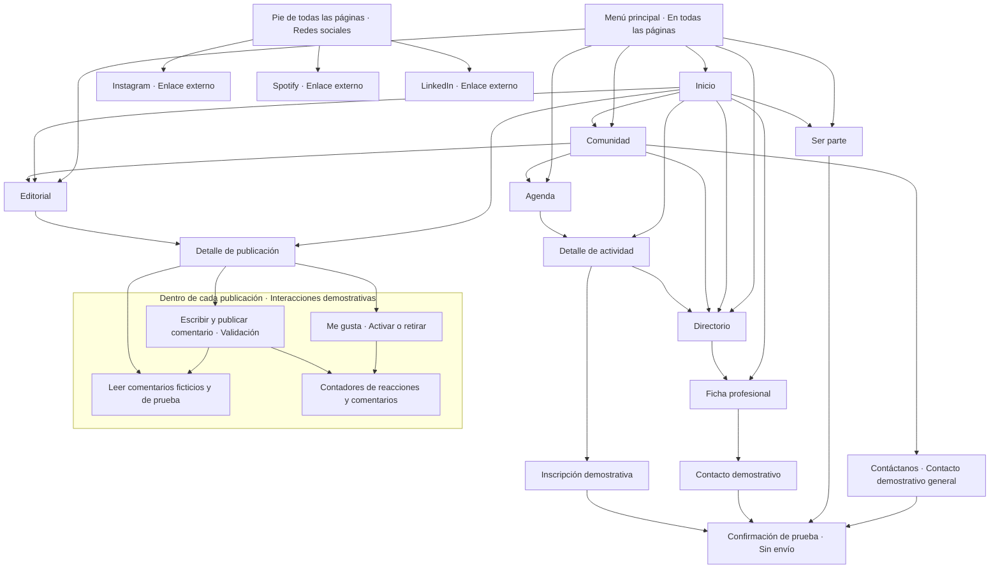

# Mapa de navegación · Espacio Arquitecta

La siguiente estructura corresponde a la maqueta simplificada. El menú principal tiene exactamente seis opciones. Las flechas muestran accesos a contenido; se omiten los enlaces de retorno y el menú compartido en cada pantalla para facilitar la lectura.

Comunidad incluye el botón «Contáctanos», que abre el contacto general demostrativo. El contacto de las fichas profesionales conserva su destinataria ficticia.

## Controles dentro de las páginas

- **Directorio:** búsqueda por nombre, ciudad o especialidad; filtros de ciudad y especialidad. Abre una ficha profesional sencilla, con información y contacto demostrativo. No contiene proyectos, galerías ni enlaces a otras fichas.
- **Editorial:** filtro de formato (Podcast, Video, Entrevista, Artículo escrito) y filtro de temática (Personas, Proyectos, Tendencias, Innovación, Sustentabilidad, Comunidad). Son clasificaciones independientes, combinables y sin páginas de categoría separadas. Una publicación puede tener varias temáticas, conservando un único registro, enlace y página de detalle.
- **Publicación:** texto e imagen o video conceptual, según el contenido. Los proyectos se presentan aquí como publicaciones; no tienen rutas, galerías ni fichas de proyecto independientes. El ejemplo de podcast contiene una sinopsis y guion ficticios, sin audio.
- **Participación dentro de cada publicación:** corazón «Me gusta» con contador y estado activado/desactivado; comentarios ficticios con nombre y contenido; campo «Escribe un comentario de prueba» y botón «Publicar comentario». Se rechaza el texto vacío o compuesto solo por espacios. Un comentario válido aparece inmediatamente como «Visitante de demostración» y actualiza el total. Los contadores también aparecen en las tarjetas editoriales. No son páginas nuevas ni requieren autenticación.
- **Estado temporal:** reacciones y comentarios de prueba se mantienen por publicación mientras se navega en la misma pestaña. Al recargar se restablecen los datos ficticios iniciales. No hay envíos al servidor, guardado permanente, respuestas anidadas, valoraciones negativas ni notificaciones.
- **Ser parte, contacto e inscripción:** formularios demostrativos. La confirmación es un estado dentro del formulario, no una página ni una recepción real.
- **Pie de página:** enlaces externos a Instagram, Spotify y LinkedIn con sus logos y nombres. Se abren en una pestaña nueva. No hay enlace a Comunidad ni otros enlaces internos en el pie.

## Rutas vigentes

| Destino | Ruta |
| --- | --- |
| Inicio | `#/inicio` (también al abrir sin hash) |
| Comunidad | `#/comunidad` |
| Directorio | `#/directorio` |
| Ficha profesional | `#/perfil/{id-profesional}` |
| Contacto general desde Comunidad | `#/contacto` |
| Contacto demostrativo profesional | `#/contacto/{id-profesional}` |
| Agenda | `#/agenda` |
| Detalle de actividad | `#/actividad/{id-actividad}` |
| Inscripción demostrativa | `#/inscripcion/{id-actividad}` |
| Editorial | `#/editorial` |
| Detalle de publicación | `#/publicacion/{id-publicacion}` |
| Ser parte | `#/participa` |

Las rutas anteriores `#/proyectos`, `#/proyecto/...`, `#/articulo/...` y `#/alcance` se retiraron y no se enlazan desde el sitio. Una dirección inexistente muestra la pantalla de contenido no encontrado con retorno a Inicio.

El alcance técnico y las posibilidades futuras se documentan en el README, sin crear nodos de navegación en el prototipo. La fuente reutilizable del diagrama está en `navegacion.mmd`.
