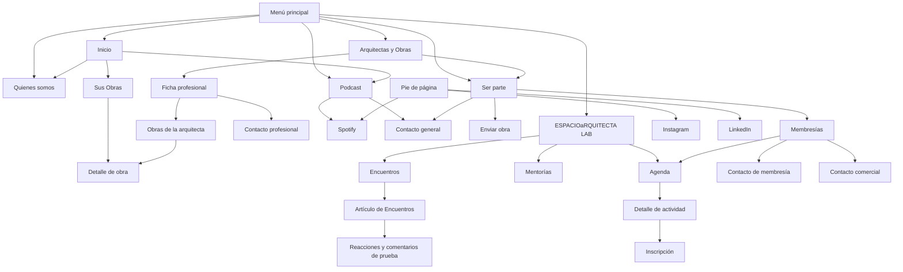

# Mapa de navegación · ESPACIOaRQUITECTA

El diagrama muestra los accesos del sitio. Las rutas usan el fragmento de la URL.

| Recorrido | Rutas |
| --- | --- |
| Portada y comunidad | `#/inicio`, `#/comunidad` |
| Directorio y perfil | `#/directorio`, `#/perfil/:id` |
| Obras | `#/proyectos`, `#/proyectos/:id` para las obras de una arquitecta |
| Podcast | `#/voces` |
| Detalles de obras | `#/publicacion/:id` |
| LAB, mentorías y artículos de Encuentros | `#/servicios`, `#/servicios/mentoria`, `#/servicios/encuentros`, `#/encuentros/:id` |
| Agenda e inscripción | `#/agenda`, `#/actividad/:id`, `#/inscripcion/:id` |
| Enviar obra y membresías | `#/participa/obra`, `#/membresias` |
| Contacto | `#/contacto`, `#/contacto/:id`, `#/contacto/membresia`, `#/contacto/publicidad` |

Los listados de Podcast y Obras permiten combinar filtros de arquitecta y tema. El episodio visible en Podcast enlaza a Spotify. Los artículos de Encuentros vuelven a su listado en el LAB. Las reacciones y comentarios de prueba se mantienen en memoria mientras se navega en la misma pestaña.
